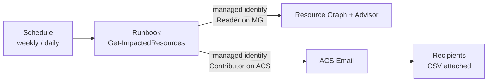
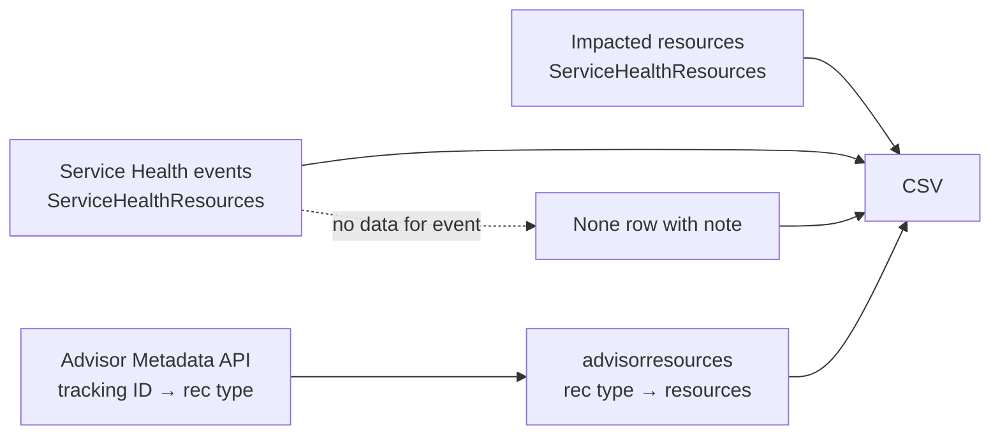

# Azure Service Health Impacted Resources

[](https://github.com/nd4ever/azure-service-health-impacted-resources/actions/workflows/ci.yml)
[](LICENSE)

Turn Azure **Service Health tracking IDs** into a **per-resource list** your IT teams can act on — in one CSV, fully automated.

## Why this exists

The **Impacted Resources** tab in Service Health is empty for many health advisories. Microsoft only publishes
resource-level data for a subset of events; retirements often expose their affected resources through **Azure Advisor**
instead, and a single retirement can use **a different tracking ID per resource type** (so the notice you received may not
be the ID that carries your resources).

This script combines both sources so every tracking ID ends up with either a resource list or an explicit
"no resource-level data" row.

| Source | What it provides |
|---|---|
| Service Health (`ServiceHealthResources` in Azure Resource Graph) | Events, titles, and impacted resources where Microsoft publishes them |
| Advisor Recommendation Metadata API | Maps a retirement **tracking ID → Advisor recommendation type(s)** |
| Advisor recommendations (`advisorresources` in Azure Resource Graph) | The actual affected resources for each retirement |

## Prerequisites

- PowerShell **5.1** (Windows PowerShell) or **7+** (Windows, macOS, Linux)
- [Azure CLI](https://learn.microsoft.com/cli/azure/install-azure-cli), signed in with `az login` (used only to obtain a token)
- **Reader** access on the subscriptions or management group you want to report on

No PowerShell modules required.

## Quick start

```powershell
# 1. Get the script
git clone https://github.com/nd4ever/azure-service-health-impacted-resources.git
cd azure-service-health-impacted-resources

# 2. Sign in and allow the script for this session
az login
Unblock-File .\src\Get-ImpactedResources.ps1          # Windows only, if downloaded
Set-ExecutionPolicy -Scope Process -ExecutionPolicy Bypass

# 3. Run
.\src\Get-ImpactedResources.ps1 -All
```

> Run the **file**. Do not paste the script's contents into the console line by line.

## Usage

| Goal | Command |
|---|---|
| Everything active, all subscriptions you can read | `.\src\Get-ImpactedResources.ps1 -All` |
| Include resolved events too | `.\src\Get-ImpactedResources.ps1 -All -IncludeResolved` |
| Limit to one management group | `.\src\Get-ImpactedResources.ps1 -All -ManagementGroup 'contoso-mg'` |
| Specific tracking IDs | `.\src\Get-ImpactedResources.ps1 -TrackingId 'ABCD-123','EFGH-456'` |
| Choose the output file | add `-OutCsv .\report.csv` |

### Parameters

| Parameter | Description |
|---|---|
| `-All` | Report every Service Health event in scope plus every Advisor retirement tracking ID. Alias: `-AllRetirements`. |
| `-TrackingId <string[]>` | One or more tracking IDs to look up. Quote them. |
| `-ManagementGroup <string>` | Management group **ID** to scope queries. Omit to search all subscriptions the signed-in account can read. |
| `-IncludeResolved` | With `-All`, include resolved events (default: active only). |
| `-OutCsv <path>` | Output path. Default: `.\impacted-resources-<yyyyMMdd-HHmm>.csv` (temp folder with `-UseManagedIdentity`). |
| `-UseManagedIdentity` | Get tokens from the managed identity endpoint instead of the Azure CLI (Automation, Functions, App Service, VMs, Arc). |
| `-ManagedIdentityClientId <guid>` | Client ID of a user-assigned identity. Omit for system-assigned. |
| `-EmailTo <string[]>` | Email the CSV to these recipients (array or `'a@x.com,b@x.com'`). Requires `-EmailFrom` and `-AcsEndpoint`. |
| `-ActionGroupId <resourceId>` | Azure Monitor action group whose **enabled email receivers** are added to the recipients (read at each run, so edit the action group to change who gets the report). Can be combined with `-EmailTo`. |
| `-EmailFrom <address>` | Sender on an email domain linked to your ACS resource, e.g. `DoNotReply@<guid>.azurecomm.net`. |
| `-AcsEndpoint <url>` | Azure Communication Services endpoint, e.g. `https://acs-x.unitedstates.communication.azure.com`. |
| `-EmailSubject <string>` | Subject line. Default: `Azure Service Health impacted resources report`. |

## Run on a schedule and email the report (Azure Automation + ACS Email)

The same script runs as an **Azure Automation runbook** (PowerShell 7.4) using the Automation account's
**managed identity**, and emails the CSV through **Azure Communication Services (ACS) Email**. The email contains a
summary table (one row per tracking ID) with the full CSV attached.



### Deploy (interactive)

```powershell
az login
.\deploy\Deploy-ImpactedResourcesReport.ps1
```

The script asks for the management group, subscription, region and recipients, then:

- **If you already have ACS** — lists the Communication Services resources you can see; pick one and pick a sender
  address from its linked email domains.
- **If you don't** (or choose `N`) — prompts to create a new **ACS + Email Communication Service with an
  Azure-managed domain** (sender `DoNotReply@<guid>.azurecomm.net`).

Non-interactive examples:

```powershell
# Create a new ACS, deploy, and send the first report right away
.\deploy\Deploy-ImpactedResourcesReport.ps1 -ManagementGroup contoso-mg -SubscriptionId <sub-id> -Location eastus `
    -EmailTo 'ops@contoso.com,cloud@contoso.com' -AcsMode new -Force -RunNow

# Use an existing ACS resource and sender
.\deploy\Deploy-ImpactedResourcesReport.ps1 -ManagementGroup contoso-mg -SubscriptionId <sub-id> -Location eastus `
    -EmailTo ops@contoso.com -AcsMode existing `
    -ExistingAcsResourceId /subscriptions/<sub>/resourceGroups/rg-comms/providers/Microsoft.Communication/communicationServices/acs-contoso `
    -SenderAddress alerts@contoso.com -Force

# Preview only
.\deploy\Deploy-ImpactedResourcesReport.ps1 -ManagementGroup contoso-mg -SubscriptionId <sub-id> -Location eastus -EmailTo ops@contoso.com -AcsMode new -WhatIf
```

| Deploy parameter | Default | Description |
|---|---|---|
| `-ManagementGroup` | prompt | Management group to report on; the runbook identity gets **Reader** here. |
| `-SubscriptionId` / `-Location` | prompt | Where the Automation account (and a new ACS) are created. |
| `-ResourceGroupName` | `rg-impacted-resources-report` | Created if missing. |
| `-AutomationAccountName` | `aa-impacted-resources` | |
| `-EmailTo` | prompt | Comma-separated recipients. |
| `-ActionGroup` | prompt | Action group **name** or resource ID; its email receivers are used as recipients. Use with or instead of `-EmailTo`. |
| `-AcsMode` | prompt | `new` or `existing`. |
| `-ExistingAcsResourceId` / `-SenderAddress` | prompt | For `existing`. |
| `-AcsDataLocation` | `United States` | For `new`. |
| `-ScheduleFrequency` / `-ScheduleWeekDays` / `-ScheduleTimeUtc` | `Week` / `Monday` / `13:00` | First run is tomorrow at that time (UTC). |
| `-IncludeResolved` | off | Include resolved events. |
| `-RunbookContentUri` | this repo, tag `v1.1.0` | Raw URL of the script to publish (point at your fork to customize). |
| `-WhatIf` / `-Force` / `-RunNow` | | Preview, skip confirmation, start one run after deploying. |

### What gets deployed ([infra/main.bicep](infra/main.bicep), management group scope)

| Resource | Notes |
|---|---|
| Resource group + Automation account | System-assigned managed identity, local auth disabled |
| Runtime environment `PowerShell-7-4` | No Az modules needed (the script uses REST) |
| Runbook `Get-ImpactedResources` | Published from `runbookContentUri` |
| Schedule + link | Runbook parameters: `-All -ManagementGroup <mg> -UseManagedIdentity -EmailTo ... -EmailFrom ... -AcsEndpoint ...` |
| Role: **Reader** on the management group | Service Health, Advisor and Resource Graph reads |
| `acsMode=new`: Email Communication Service, `AzureManagedDomain`, Communication Services (linked) | |
| Role: **Contributor** on the Communication Services resource | Required for Entra ID (managed identity) auth to ACS Email |

Deploy directly with the Azure CLI if you prefer:

```bash
az deployment mg create --management-group-id contoso-mg --location eastus \
  --template-file infra/main.bicep \
  --parameters subscriptionId=<sub-id> location=eastus emailTo=ops@contoso.com acsMode=new
```

**Who can deploy:** Owner (or Contributor + User Access Administrator) on the management group, because the template
creates role assignments.

### Redeploying or updating an existing deployment

Rerun the deploy script with the **same resource group and Automation account names** you used the first time.
The deployment then updates the existing resources in place. If you leave them out, the defaults
(`rg-impacted-resources-report` / `aa-impacted-resources`) are used, and if those differ from your original names you
get a **second** Automation account and duplicate emails.

```powershell
.\deploy\Deploy-ImpactedResourcesReport.ps1 -ManagementGroup contoso-mg `
  -SubscriptionId <sub-id> -Location eastus `
  -ResourceGroupName <your-existing-rg> -AutomationAccountName <your-existing-automation-account> `
  -ActionGroup <action-group-name> -AcsMode existing `
  -ExistingAcsResourceId /subscriptions/<sub>/resourceGroups/<rg>/providers/Microsoft.Communication/communicationServices/<acs-name> `
  -SenderAddress <sender>@<domain>
```

- Use `-AcsMode existing` on a redeploy even if the first deployment created the ACS resource. Otherwise a new ACS
  resource is created.
- Omit `-RunbookContentUri` to pick up the runbook from the release tag the template points to. Pass it only to
  publish a fork or branch.
- Automation job schedules can't be updated in place. The deploy script removes the runbook's previous schedule link
  first. If you redeploy with `az deployment mg create` directly, delete the old link (Automation account > Schedules)
  to avoid duplicate runs.
- Recipients that come from `-ActionGroup` are read on every run, so changing the action group doesn't need a redeploy.

**Azure-managed domain limits:** the free `azurecomm.net` domain has low sending limits and is meant for testing and
low volume. For production, add a custom domain to the Email Communication Service and use `-AcsMode existing`.

## Output

One row per resource per tracking ID. See [examples/sample-output.csv](examples/sample-output.csv).

| Column | Description |
|---|---|
| `trackingId` | Service Health tracking ID |
| `eventTitle` | Notice title (falls back to the Advisor recommendation name when the notice isn't in your Service Health) |
| `titleSource` | `ServiceHealth` or `Advisor` — where `eventTitle` came from |
| `eventType` / `eventSubType` / `eventStatus` | e.g. `HealthAdvisory` / `Retirement` / `Active` |
| `source` | `ServiceHealth`, `Advisor`, or `None` (no resource-level data) |
| `subscriptionId`, `resourceGroup`, `resourceName`, `resourceType`, `region`, `resourceId` | The affected resource |
| `recommendation`, `retirementFeature`, `retirementDate` | Advisor retirement details |
| `note` | Explanation for `None` rows and Advisor-only tracking IDs |

### Reading the `source` column

- **ServiceHealth** — Microsoft listed the resource on the event's Impacted Resources tab.
- **Advisor** — The resource is affected by a retirement linked to this tracking ID via Advisor.
  If `note` says *Advisor-only tracking ID*, the retirement affects you but that notice ID was never delivered to your Service Health.
- **None** — Microsoft published no resource-level data for this event. Typical for billing, informational, and
  platform-wide advisories. Options: build a custom Azure Resource Graph inventory query for the affected SKU/API/runtime,
  or open a support request quoting the tracking ID.

## How it works



1. Lists Service Health events in scope (active only unless `-IncludeResolved`).
2. Pulls Service Health impacted resources for those events.
3. Maps every Advisor retirement recommendation type to its tracking IDs, then pulls the affected resources.
4. Adds a `None` row for any event with no resource-level data, so every tracking ID is accounted for.

All Azure calls use REST (`Invoke-RestMethod`) with a token from `az account get-access-token`, which avoids
Windows `az.cmd` quoting issues and pages through results larger than 1,000 rows automatically.

## Troubleshooting

| Symptom | Fix |
|---|---|
| `The term 'TID=$1' is not recognized` / `sed` errors | You're running Bash syntax in PowerShell. Use this `.ps1` script. |
| `Supply values for the following parameters` | The script was pasted into the console. Save it as a file and run the file. |
| `ManagementGroupsNotFoundInTenant` | Use the management group **ID** (not display name), or omit `-ManagementGroup`. |
| `Could not get a token` | Run `az login` (and `az account show` to confirm). |
| Script blocked by execution policy | `Set-ExecutionPolicy -Scope Process -ExecutionPolicy Bypass` and `Unblock-File`. |
| Many `None` rows | Expected — Microsoft doesn't publish resource lists for those events. See *Reading the source column*. |
| Runbook: `403` / `AuthorizationFailed` on Resource Graph | Reader on the management group can take a few minutes to apply after deployment. Rerun the job. |
| Runbook: `401`/`403` from `emails:send` | The identity needs **Contributor** on the Communication Services resource (not the Email service). |
| Runbook: `DomainNotLinked` / `InvalidSenderUserName` | `-EmailFrom` must be on a domain **linked** to that ACS resource (ACS > Email > Domains). |
| Email arrives without attachment | CSV over ~7 MB is not attached (ACS 10 MB limit). Narrow with `-ManagementGroup`. |

## Limitations

- Coverage depends on what Microsoft publishes. Impacted resources can take up to two weeks to appear after an event is published.
- The Advisor mapping covers **retirements** only.
- Tenant-scoped Service Health events are not included.
- Azure public cloud only (sovereign clouds use different endpoints).

## Testing

Tests run offline against mocked Azure responses — no subscription needed:

```powershell
./tests/Invoke-MockTests.ps1
```

Managed identity and ACS email calls are mocked too. CI runs PSScriptAnalyzer, `bicep build` + `bicep lint`
(warnings fail the build) and the tests on Windows PowerShell 5.1 and PowerShell 7 (Windows + Linux).
The CI logic lives in [tests/Invoke-CI.ps1](tests/Invoke-CI.ps1) (`-Task Lint` or `-Task Test`); failures are
surfaced as annotations on the workflow run summary.

## References

- [Impacted resources from Azure Health Advisories](https://learn.microsoft.com/azure/service-health/impacted-resources-retirements)
- [Service retirement alerts and actions – choosing the right signal](https://learn.microsoft.com/azure/service-health/service-retirement-alerting-guidance)
- [Azure Resource Graph sample queries for Service Health](https://learn.microsoft.com/azure/service-health/resource-graph-samples)
- [Azure Communication Services Email overview](https://learn.microsoft.com/azure/communication-services/concepts/email/email-overview)
- [Azure Automation runtime environments](https://learn.microsoft.com/azure/automation/runtime-environment-overview)

## License

Copyright (c) 2026 nd4ever

Licensed under the [MIT License](LICENSE). You may use, copy, modify, merge, publish, distribute, sublicense,
and/or sell copies of this software, provided the copyright notice and permission notice are included in all
copies or substantial portions of the software. The software is provided "as is", without warranty of any kind.
See [LICENSE](LICENSE) for the full text.

The license notice is also embedded in [src/Get-ImpactedResources.ps1](src/Get-ImpactedResources.ps1)
(view it with `Get-Help .\src\Get-ImpactedResources.ps1 -Full`), so it travels with the script if it's copied on its own.
